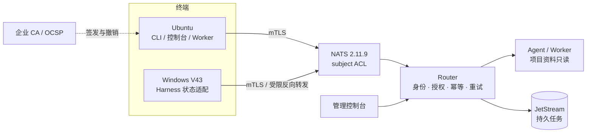
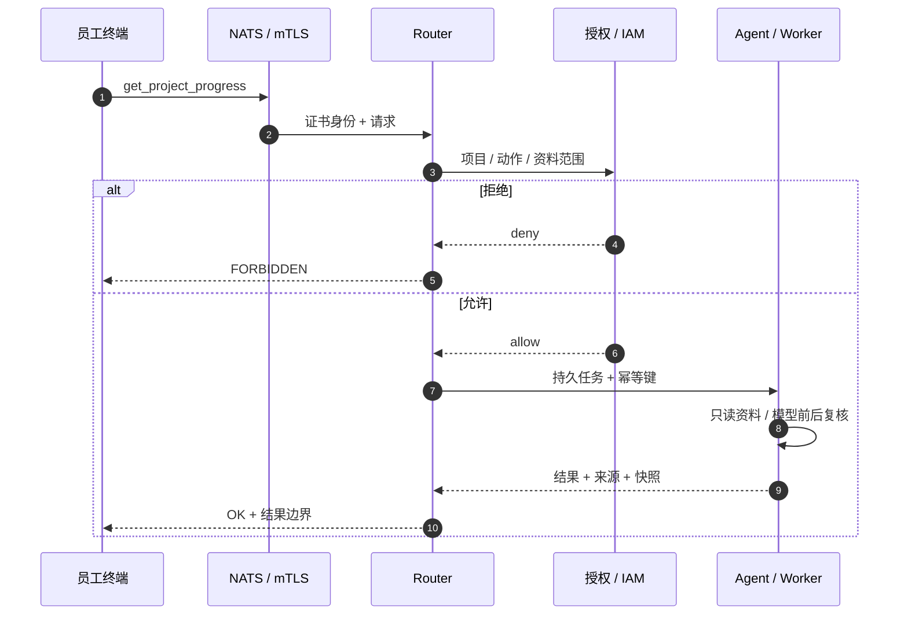
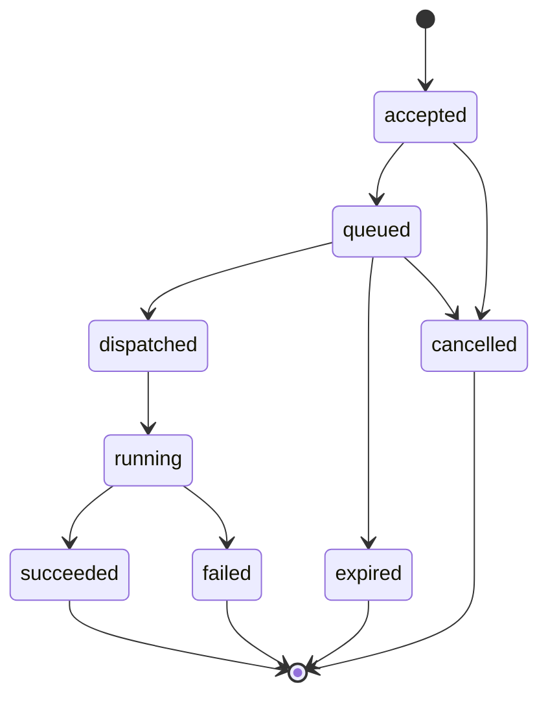
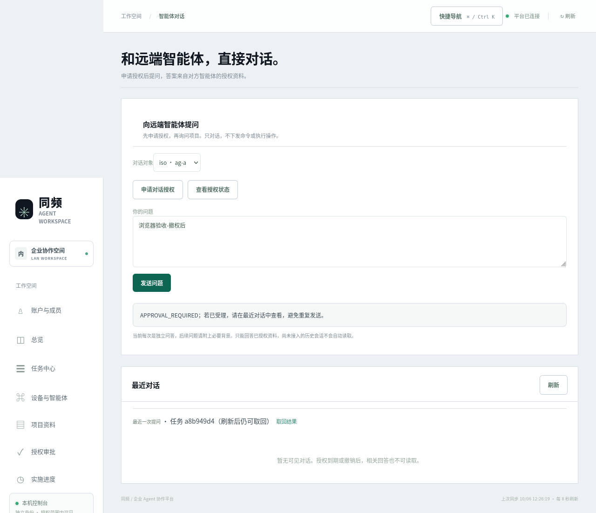

# 企业内网 Agent 协作平台

<p align="center">
  
  
  
  
  
  
  
  
  
  
  
</p>

**CI**：[Linux 离线检查](https://github.com/MCYX12/company-ai-network/actions/workflows/ci.yml) · [Windows 客户端](https://github.com/MCYX12/company-ai-network/actions/workflows/windows-client.yml) · 当前 `main` 全绿

在纯内网环境中，用 mTLS 身份、最小权限和可审计的投递链路，让员工跨电脑询问项目进展与当前工作。

**当前定位**：可运行的企业内网 PoC / 受控试用基线。工程实现与受控环境验证基本完成；**企业生产准入尚未通过**（`production_ready=false`）。现场门禁见 [验收矩阵](docs/ACCEPTANCE_MATRIX.md) 与 [剩余工作](docs/REMAINING_WORK.md)。

> 公开仓库只包含源码、文档、测试和示例配置；验收证据、现场地址、证书、私钥和运行数据库不随仓库发布。

## 项目是什么

企业里的项目状态通常散落在聊天记录、文档和个人电脑里。员工想知道“这个项目到哪了”“对方现在在做什么”，往往要打断别人、翻历史消息，或者把资料发到公网模型上。

本项目把这条链路收敛为：

1. **身份先行**：终端用 mTLS 证书接入，证书映射到唯一 Agent 身份；每个身份只能发布/订阅自己的 subject。
2. **默认拒绝**：项目、动作、资料范围都要显式授权；越权请求在 Router 侧被拒绝，不依赖模型“自觉”。
3. **只读业务**：当前开放 `get_status`、`get_project_progress` 和受控 `ask_peer`，不开放有副作用的远程执行。
4. **可靠投递**：任务编号、幂等、持久账本、outbox、重试、死信和租约，离线/重启后可恢复。
5. **可审计**：身份、授权、任务状态和结果边界都有记录；资料回答标注来源与快照时间。

它**不是**公网 SaaS，**不是**通用远程执行平台，也**不是**已经通过企业生产认证的系统。

## 核心能力

| 能力 | 当前实现 |
|---|---|
| 传输与身份 | 真实 NATS 2.11.9；mTLS；证书映射身份；每 Agent subject ACL；短期重放拒绝；自动重连 |
| 授权与身份治理 | 项目范围默认拒绝；OIDC/JWT + JWKS；在职名册；人工撤权优先且粘滞；授权依赖不可读时 fail-closed |
| 可靠任务 | 持久任务账本；幂等提交；outbox；重试与死信；JetStream 持久派发；租约/fencing |
| 业务动作 | `get_status`（执行/待回传状态）、`get_project_progress`（项目记录）、`ask_peer`（受控问答） |
| 项目记录 | 机器观测、人工确认、发布时间三个时钟分离；来源、快照和新鲜度可见；自动刷新不替代人工确认 |
| 终端 | Ubuntu CLI / 控制台；Windows V43 客户端；跨网段受限 SSH 反向转发；macOS 端本轮冻结 |
| 运维 | 健康检查、告警落盘、JSONL 审计、在线备份/恢复、灾备演练、发布门禁 |

## 技术栈

| 层 | 技术选型 | 作用 |
|---|---|---|
| 传输 | NATS 2.11.9 · mTLS · subject ACL | 私有网络内的认证消息总线，按身份隔离发布/订阅 |
| 身份 | X.509 · OIDC/JWT · JWKS | 证书映射 Agent 身份；企业令牌映射员工在职状态 |
| 可靠投递 | JetStream · SQLite · 共享 KV | 持久任务、幂等键、outbox、租约、死信 |
| 运行时 | Python 3.11 · systemd · Windows SCM | Linux / Windows 终端的服务化运行 |
| 观测 | JSONL 审计 · 健康检查 · 告警落盘 | 任务、授权、结果边界可追溯 |
| 发布 | 双 CI · SHA256 · 客户端签名 | 从零构建、内容摘要校验、产物可复核 |

**关键词**：`mTLS` · `X.509` · `OIDC/JWT` · `JWKS` · `NATS` · `JetStream` · `SQLite WAL` · `outbox` · `idempotency` · `DLQ` · `fencing` · `OCSP/CRL` · `RBAC` · `WORM` · `RTO/RPO`

## 架构



- **NATS** 只暴露私有网络地址，测试环境默认监听 `127.0.0.1:14222`。
- **Router** 是业务授权和任务状态的权威入口；客户端不能直接向 Worker 派发。
- **Agent / Worker** 只读已授权项目资料；模型调用前后都重新检查授权。
- **管理控制台** 通过管理员身份访问审批、成员、项目记录和健康状态。

### 请求生命周期



### 任务状态机



## 快速开始（本机 PoC）

需要 Python 3.11+、[uv](https://docs.astral.sh/uv/)、OpenSSL；准备 NATS 二进制时需要 Docker（仅用于从固定官方镜像提取，不会启动业务容器）。

```bash
git clone https://github.com/MCYX12/company-ai-network.git
cd company-ai-network

uv sync --frozen

# 生成 7 天有效的测试 CA / 证书，以及本地 NATS 配置
.venv/bin/python scripts/bootstrap.py

# 提取并校验 NATS 2.11.9；若已有原生二进制，可设 NATS_SERVER=/绝对路径
.venv/bin/python scripts/prepare_server.py
```

启动本地 PoC（NATS + Router + 测试 Agent `ag-b`）：

```bash
.venv/bin/python scripts/run_local.py
```

另开一个终端，查询目录和状态：

```bash
.venv/bin/python -m app.client --list
.venv/bin/python -m app.client --action get_status --target ag-b
```

越权演示（`ag-c` 不属于 `ag-b` 的项目范围）：

```bash
.venv/bin/python -m app.client --identity ag-c
# 预期 code=FORBIDDEN
```

启动本机控制台：

```bash
POC_RUNTIME=.runtime NATS_URL="$(cat .runtime/endpoint.txt)" \
  .venv/bin/python -m app.dashboard --identity ag-a --port 8787 --admin
```

浏览器打开 <http://127.0.0.1:8787>。按 `Ctrl-C` 只会停止 `run_local.py` 自己启动的进程。

> 局域网/Windows 部署、证书和反向转发见 [部署指南](docs/DEPLOYMENT.md)；不要把测试 CA 或 `.runtime` 目录分发给终端。

## 控制台



*管理员审批、对话、任务状态、项目资料与健康检查在同一控制台；授权撤销或到期后，相关历史结果不可再读。截图为受控环境实机验收。*

## 验证

完整离线回归（需要已准备的 `.runtime/bin/nats-server`）：

```bash
.venv/bin/python -m unittest discover -s tests -p 'test_*.py'
```

当前基线：**1036 项通过**；两个 CI 工作流同时覆盖 Linux 离线检查和 Windows 客户端。CI 从零安装固定版 NATS 并校验 SHA256，不依赖提交进仓库的运行时目录。

真实中间件集成验收（会启动独立的 NATS / Router / Agent，结束后清理）：

```bash
.venv/bin/python tests/integration.py
```

发布校验：

```bash
# 本机已准备运行时：提交、内容摘要、制品和公开源卫生一起校验
.venv/bin/python -m scripts.verify_release --strict

# 全新 clone / CI：允许暂缓缺失 NATS 二进制，但不放宽源码与清单校验
.venv/bin/python -m scripts.verify_release --gate
```

## 目录结构

| 路径 | 内容 |
|---|---|
| `app/` | Router、Agent/Worker、授权、IAM、任务账本、审计、控制台等核心模块 |
| `scripts/` | 启动、证书、NATS 准备、发布、备份与演练工具 |
| `tests/` | 1036 项离线回归与真实中间件集成演练 |
| `docs/` | 基线、验收、生产准入、运维和现场清单 |
| `schemas/` | 严格请求 JSON Schema |
| `packaging/` | systemd / Windows / launchd 部署模板 |
| `web/` | 控制台前端资源 |
| `config/` | 站点 profile、身份目录和示例配置 |

## 安全与隐私

- `.runtime`、`.runtime-lan` 和 `.runtime-*` 已加入 `.gitignore`，其中包含本机证书、审计和任务账本。
- 测试 CA / 证书默认只有 **7 天**有效期；`bootstrap.py` 不覆盖既有凭据。需要重建时先停服务并备份 `.runtime`。
- 公开仓库不提交私钥、证书、SQLite 备份、运行日志或验收证据；发布门禁 `scripts/check_public` 会阻断运行时产物和私钥材料。
- 生产密钥应放在所有者独占目录或 HSM；不要通过 Git、聊天或工单传递。
- 当前业务动作均为只读；模型输出经过授权检查和出口校验，不把未授权资料带入提示词。

## 实测指标

| 测量项 | 结果 | 条件 |
|---|---|---|
| 离线回归 | **1036 / 1036** | Linux · Python 3.11 |
| Windows 客户端 | **39 / 39** | GitHub Windows runner |
| 跨网段稳定性 | **108 / 108** 查询成功 | 180 秒 · 5 秒间隔 |
| 目录查询 P95 | **25.3 ms** | 2026-10-10 当前环境 |
| Windows 状态 P95 | **186.4 ms** | 同上 |
| 项目进展 P95 | **43.9 ms** | 同上 |
| 转发故障自动恢复 | **13.6 秒** | 强制结束转发主进程后 |

> 以上是当前开发环境的单次工程样本，用于可重复自证，不是 SLA，也不是企业容量/生产验收。容量目标与现场证据要求见 [验收矩阵](docs/ACCEPTANCE_MATRIX.md) 和 [剩余工作](docs/REMAINING_WORK.md)。

## 当前状态与边界

| 维度 | 状态 |
|---|---|
| 工程实现 | 可运行；1036 项回归通过；Linux / Windows CI 全绿；发布门禁完整 |
| 受控环境验证 | Ubuntu 与 Windows 双向状态/项目进展查询；跨网段受限反向转发；180 秒稳定性采样 |
| 企业生产准入 | **未通过**：真实 IdP、物理三故障域 + 双 Router、真实内网模型断公网冷启动、100 QPS 容量、不可变审计、异地 DR、50–200 人试点、三方签字均待现场完成 |

这意味着：**测试通过、CI 全绿和历史证据，都不等于企业生产就绪。** 当前版本适合本机 PoC、受控试用和现场准入准备，不应直接承载生产业务。

## 文档

| 文档 | 用途 |
|---|---|
| [架构说明](docs/ARCHITECTURE.md) | 组件、请求路径、任务状态和部署拓扑 |
| [部署指南](docs/DEPLOYMENT.md) | 本机、局域网、Windows 与跨网段部署 |
| [安全模型](docs/SECURITY.md) | 身份、授权、模型边界、审计和威胁模型 |
| [运维手册](docs/OPERATIONS.md) | 服务、健康检查、备份、证书续期和回滚 |
| [测试与门禁](docs/TESTING.md) | 测试分层、CI、发布校验和写测试约定 |
| [当前基线](docs/BASELINE.md) | 已实现范围、兼容性和非目标 |
| [验收矩阵](docs/ACCEPTANCE_MATRIX.md) | 对照计划书 §16 的逐项状态 |
| [剩余工作](docs/REMAINING_WORK.md) | 生产准入 E-01～E-12 与工程侧待办 |
| [实施进度](docs/PLAN_STATUS.md) | P0–P5 阶段摘要 |

## 参与

欢迎通过 Issue 或 Pull Request 提交问题、文档修正和可复现的测试。涉及安全问题的细节请先私下联系维护者，不要在公开 Issue 中粘贴密钥、内网地址或业务资料。

## License

[MIT](LICENSE)
