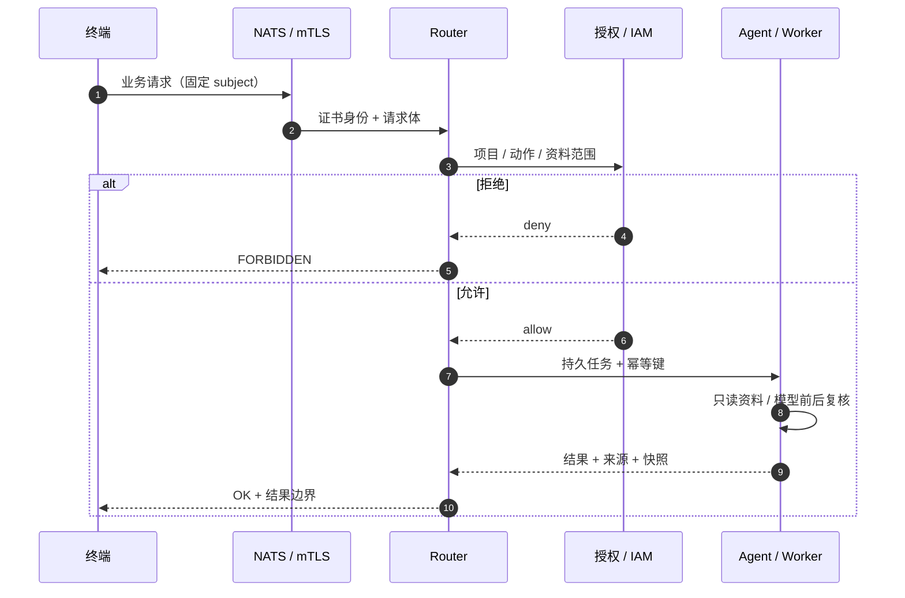
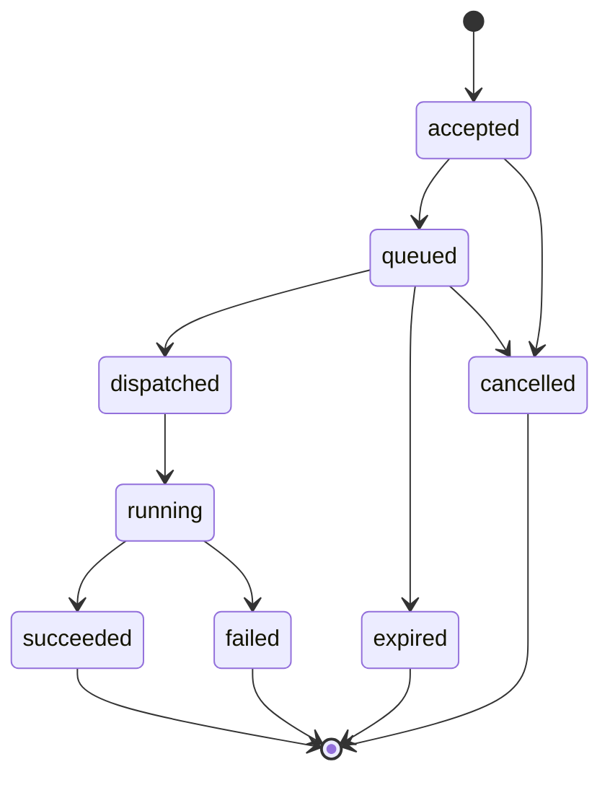

# 架构说明

本文描述平台的组件边界、请求路径和信任模型。实现不依赖公网服务；生产部署只需要内网 NATS、证书和时间同步。

## 组件

| 组件 | 职责 | 关键边界 |
|---|---|---|
| NATS Server | 认证消息总线 | mTLS、subject ACL、JetStream 持久化 |
| Router | 业务入口与权威状态 | 证书身份、项目授权、幂等、重试、结果出口 |
| Agent / Worker | 执行只读业务动作 | 只能读取已授权项目资料，模型调用前后复核 |
| Directory | 设备/Agent 能力目录 | 心跳、在线状态、构建与能力可见性 |
| Dashboard | 管理员/用户控制台 | 会话、审批、任务、项目资料和健康状态 |
| CA / OCSP | 证书签发与撤销 | 测试环境用本地 CA；生产接企业 CA |
| Store | 任务/授权/审计状态 | SQLite WAL，HA 模式使用共享 KV |

## 请求路径



## 任务状态



## 数据与存储

- **任务账本**：任务号、幂等键、重试链、状态事件和结果确认。
- **授权账本**：项目/动作/资料范围、审批、撤销、历史范围。
- **审计**：最小 JSONL 记录；生产环境应外发到独立不可变存储。
- **JetStream**：持久派发；Router 只有在 durable 写入后 ACK。
- **共享 KV**：HA 模式下的任务、租约和幂等索引。

## 部署拓扑

```text
终端 A ─┐
终端 B ─┼── mTLS ── NATS ── Router ── Worker / Agent
终端 C ─┘                     │
                              ├── Dashboard（管理员）
                              └── CA / OCSP
```

单机 PoC 使用 `127.0.0.1:14222`；LAN 部署把 NATS 暴露在受控内网地址，并为每个终端签发独立证书。跨网段/跨 Wi-Fi 场景可使用受限 SSH 反向转发，但必须保留 mTLS 校验。

## 非目标

- 不提供通用远程 Shell 或任意命令执行。
- 不把模型直接挂到文件系统；资料读取始终经过授权和路径约束。
- 不声称单机 PoC 等同于企业生产 HA/容量/合规验收。
